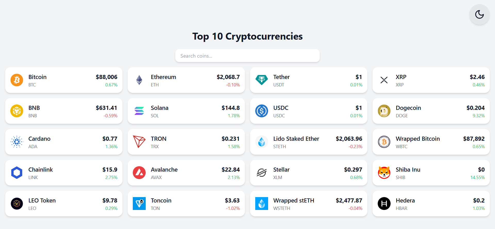

# 💸 Crypto Dashboard

A responsive, modern cryptocurrency dashboard built with React 19 and Vite, powered by real-time data from the CoinGecko API.



[🌍 Live Demo](https://akopjandvd.github.io/crypto-dashboard/) • [🧪 CI Status](https://github.com/akopjandvd/crypto-dashboard/actions)

---

## ✨ Features

- 🔍 Real-time coin search with filtering
- 🌗 Animated dark/light mode toggle (🌞 / 🌙)
- 🔄 Live price updates from CoinGecko API
- 📱 Fully responsive and mobile-friendly layout
- ✅ Unit & component tests with Vitest and Testing Library
- ⚙️ Continuous Integration via GitHub Actions
- 🌍 Deployed with GitHub Pages

---

## 🛠️ Tech Stack

- [React 19 (canary)](https://react.dev)
- [Vite](https://vitejs.dev)
- [Tailwind CSS](https://tailwindcss.com)
- [Framer Motion](https://www.framer.com/motion/)
- [Lucide Icons](https://lucide.dev)
- [CoinGecko API](https://www.coingecko.com/en/api)

---

## 🧪 Testing

```bash
npx vitest run
```

The project uses `vitest` and `@testing-library/react` to provide fast and reliable tests.  
Tests include mock API responses and simulated user interactions.

CI keeps the `test` result on every main push and PR. It checks the complete
event diff before installing application dependencies; only changes confined to
this README can use document consistency checks. Source, tests, configuration,
dependencies, workflows, unknown paths, renames or unavailable history run the
existing Vitest flow. Superseded ordinary runs are cancelled. Scope regression
tests run with `python3 -B .github/scripts/test_ci_scope.py` without npm packages.
Manual workflow dispatch always runs full validation and has a separate,
non-cancelling group. Checkout credentials are not persisted; CI uses read-only
repository permissions and does not enable hosted dependency caching.

---

## 🚀 Deployment

The app is deployed using GitHub Pages from the `gh-pages` branch.

```bash
npm run deploy
```

Make sure to update the `base` path in `vite.config.js` with your repository name:

```js
base: "/crypto-dashboard/"
```

---

## 📸 Screenshot

> Add a screenshot of your app as `screenshot.png` in the project root to showcase your UI.

---

## 📍 Roadmap

- [ ] 📈 Historical price chart (Chart.js / Recharts)
- [ ] ⭐ Add to favorites (using `localStorage`)
- [ ] 🔔 Price alert notifications
- [ ] 👤 User authentication
- [ ] 🤖 AI-generated price summaries (local LLM or OpenAI API)

---

## 👤 Author

> [@akopjandvd](https://github.com/akopjandvd) – Software engineer. This project was created for portfolio and learning purposes.
